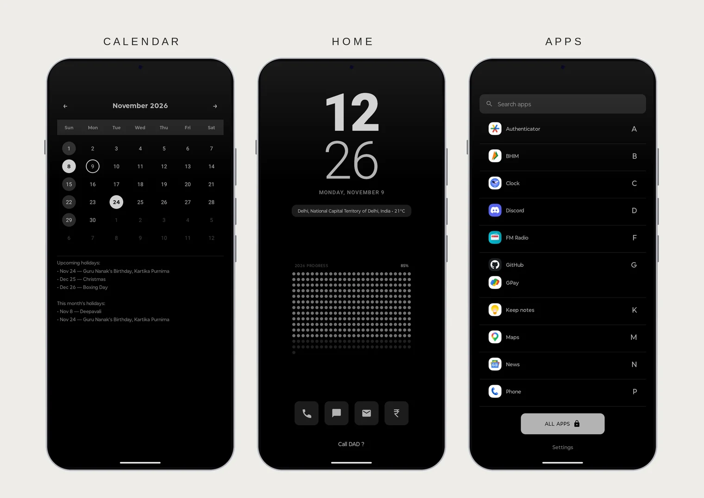
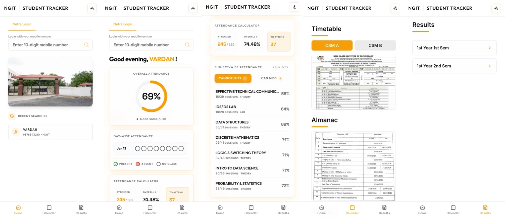
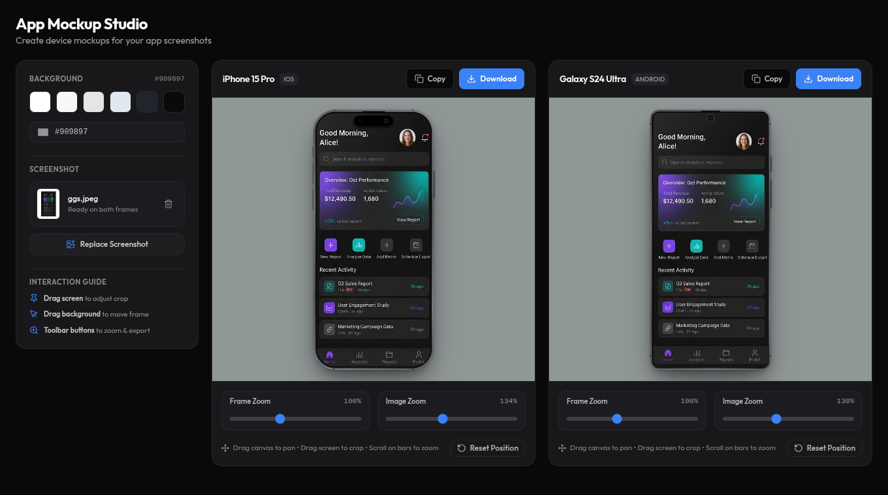
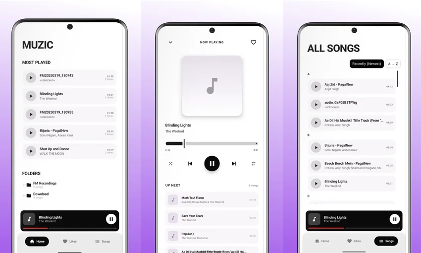
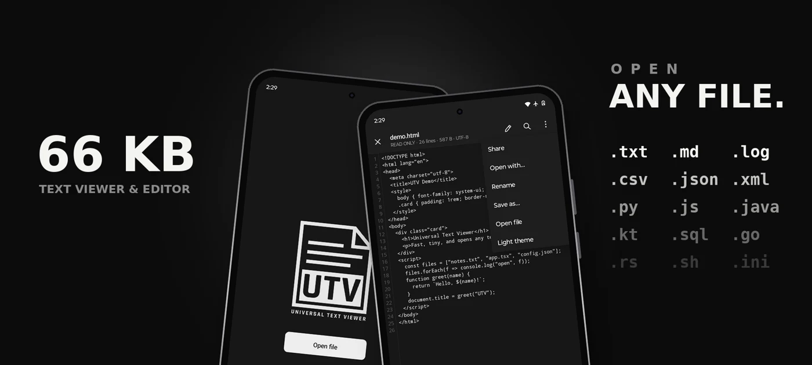

# Vardhan

I am a pre-final year CSE (AI & ML) student at NGIT. I build software that solves real-world problems and learn cybersecurity by playing CTFs with the localhost969 team.

## Selected work

### 01. Live

A quieter Android launcher with an optional passcode for the full app drawer.

[Get the APK](https://github.com/localhost969/live/releases/latest) · [Source](https://github.com/localhost969/live)

---

### 02. NGIT24

Attendance, timetables, and semester results for NGIT and KMEC students.

[Open NGIT24](https://ngit24.vercel.app) · [Source](https://github.com/localhost969/ngit24)

---

### 03. App Mock Studio

Turn a screenshot into an iPhone or Galaxy mockup.

[Open the editor](https://app-mock-studio.vercel.app) · [Source](https://github.com/localhost969/app-mock-studio)

---

### 04. Muzic

A minimal Android music player that deliberately hides album art.

[Get the APK](https://github.com/localhost969/muzic/releases/latest) · [Source](https://github.com/localhost969/muzic)

---

### 05. UTV

An Android text editor for everything from source code to large logs. About 66 KB.

[Get the APK](https://github.com/localhost969/UTV/releases/latest) · [Source](https://github.com/localhost969/UTV)

## LeetCode

## Tech stack

**Languages**

**Web & APIs**

**Mobile**

**Data & cloud**

**DevOps**

